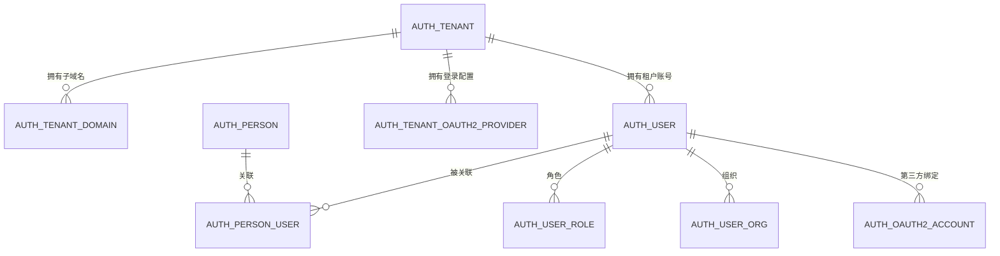

# NEBULA 多租户需求与架构设计

> 状态：设计定稿，待实施  
> 适用模块：`nebula-base-*`、`nebula-auth`、`nebula-dict`、`nebula-param`、`nebula-notify`、`nebula-storage`、`nebula-scheduler`、`nebula-audit`、`nebula-event`、`nebula-frontend`、`nebula-gateway`、`web`、`control`、`mobile`、`packages/client-sdk`  
> 目标：在 NEBULA 中实现“控制平面与数据平面分离 + 每租户独立子域名 + 平台账号强制绑定 + 租户内账号 + 租户级登录配置 + 手动切换企业”的多租户能力。

---

## 0. 结论先行

1. **平台账号是硬需求，且强制绑定。**  
   每个租户用户必须关联一个 ACTIVE 的平台账号（`auth_person`），否则不能签发租户会话。租户认证成功后没有有效绑定的，进入绑定挑战；用户可选择按租户用户名创建并绑定新平台账号，或验证已有平台账号后绑定。

2. **平台账号与租户账号分离。**  
   `auth_person` 只回答“你是谁”；`auth_user` 回答“你在该租户是谁、有什么角色”。平台账号不携带任何租户权限。

3. **控制平面与数据平面分离。**  
   控制平面是独立前端工程 `control/`，部署在独立域名或独立端口，只允许超级管理员登录，负责企业生命周期、域名、成员邀请和全局用户查询；数据平面 `web/` 部署在各租户子域名，只承载租户业务与租户内管理。两者复用同一个后端，但使用独立的登录入口、导航和本地令牌存储。

4. **每个租户一个子域名，暂不做自定义域名。**  
   例如 `acme.app.example.com`。所有租户共享一个 base domain，使用通配证书。控制平面使用独立域名（如 `console.example.com`）或独立端口，不复用租户子域名，也不通过租户菜单进入。

5. **切换租户 = 导航到目标子域名，不做跨租户换令牌。**  
   目标子域已有有效租户令牌就直接进入；没有就进入该租户登录页。切换失败/未登录时重新认证是正常流程，不提供 `switch` 接口或 SSO 一次性 code。

6. **平台账号提供独立的登录方式，与租户账号登录并列。**  
   多租户模式下，租户登录页额外提供「平台账号登录」方式（类似 GitHub 登录的独立入口），用户直接输入平台账号 + 密码。该方式先查平台账号在本租户是否有 ACTIVE 关联，没有则直接报错，不进入密码校验；有则校验平台密码并签发该租户会话。原有租户用户名 + 密码登录保持原语义，不受影响。控制平面使用独立入口 `POST /api/auth/platform-login`，直接认证 `auth_person` 中的平台管理员账号，签发不绑定任何租户的平台会话；非平台管理员即使密码正确也会被拒绝。`username` 全局唯一、统一小写存储、直接比对；`display_name` 负责展示，两者分开。

7. **平台账号自助集成在个人详情页。**  
   多租户模式下数据平面的个人详情页提供「企业个人信息 / 平台个人信息」两个页签：前者管理当前企业的账号，后者查看平台账号资料、联系方式和已关联企业。该页签使用当前租户令牌，不依赖控制平面。

8. **OAuth2 配置按租户隔离。**  
   平台维护 provider 目录，租户管理员配置本租户的 client_id/secret/回调；超级管理员可以在控制平面代配。租户 OAuth 只签发租户会话，不自动成为平台账号。

9. **超级管理员不提供跨租户代登录。**  
   超级管理员排障时不签发任何跨租户令牌，也没有只读旁路；由租户提供该租户内的账号和密码，平台人员以普通租户用户身份登录查看。

10. **不做存量数据迁移和回填。**  
    只修改全量初始化 SQL；不提供 `unreleased` 增量迁移脚本。已有数据的部署不在本次范围内。

11. **默认单租户兼容。**  
    `nebula.tenant.enabled=false` 时保持现有单租户登录行为；开启多租户后平台账号层随租户模式自动启用，并强制绑定。

12. **默认超级管理员账号为 `superadmin`。**  
    初始化 SQL 中只创建全局平台账号 `auth_person.username=superadmin`、`platform_admin=1`；它不绑定默认租户，也不在默认租户内创建同名 `auth_user`、角色或关联记录。超级管理员只存在于控制平面。后端能力标记仍保留字段名 `platform_admin`。

13. **企业资料由租户自助维护，平台保留兜底编辑能力。**
    数据平面「系统管理 → 企业设置」由租户管理员维护企业名称、简称、Logo、对外联系方式、官网、地址、行业、简介、默认语言/时区与登录页品牌；企业代码、域名、状态仍由平台持有，租户只读。企业设置使用 `TENANT_PROFILE_QUERY` / `TENANT_PROFILE_UPDATE` 权限码，内置 `ADMIN` 默认授权，自定义角色可按需授予。控制平面仍可编辑同样字段，但属于排障/交付手段，不写租户审计、不通知租户。移动端只读展示企业资料，不提供编辑入口。

---

## 1. 术语与身份模型

| 术语 | 表 | 说明 |
|---|---|---|
| 控制平面 | `control/` | 独立前端工程，超级管理员专用：企业生命周期、域名、邀请、全局用户 |
| 数据平面 | `web/` | 部署在租户子域名的业务管理端，只承载租户内能力 |
| 租户 | `auth_tenant` | 企业/组织，多租户隔离边界 |
| 租户编码 | `auth_tenant.code` | 公开、不可变，可下发给用户 |
| 租户子域名 | `auth_tenant_domain.domain` | 如 `acme.app.example.com` |
| 平台账号 | `auth_person` | 全局身份，不自带登录会话 |
| 超级管理员 | `auth_person.platform_admin=1` | 可登录控制平面的平台账号；默认账号 `superadmin` |
| 平台账号-租户账号关联 | `auth_person_user` | 一个 person 关联多个租户用户 |
| 租户账号 | `auth_user` | 租户内身份，角色/组织/权限的授权主体 |
| 租户会话 | tenant session | 绑定 `tenantId + userId + personId`，是唯一登录态 |
| 租户级 OAuth 配置 | `auth_tenant_oauth2_provider` | 每个租户自己的第三方登录 App |

关系：



**核心原则：**

- `auth_person.id` 是人的全局身份；
- `auth_user.id` 是人在某个租户内的身份；
- 角色、组织、权限、数据范围只挂在 `auth_user` 上；
- 平台账号不能直接访问租户数据，必须通过关联的 `auth_user` 签发租户会话。

---

## 2. 总体架构

### 2.1 域名布局

```text
example.com                     官网/营销（可选）
console.example.com             控制平面：超级管理员专用（推荐独立域名）
app.example.com                 数据平面 base domain
acme.app.example.com            租户 A
beta.app.example.com            租户 B
```

- 租户子域名**只做一层**，base domain 建议为 `app.example.com`，通配证书 `*.app.example.com`。
- 控制平面使用独立域名（如 `console.example.com`）或独立端口，**不要**放在租户 base domain 下；如果必须放在同一 base domain，必须把该标签加入保留子域名，避免被解析为租户。
- 控制平面登录不携带 `X-Tenant-Code`，也不依赖 Host 解析租户；平台会话从不绑定租户。
- 不提供 `api.<tenant>` 之类按租户拆分的 API 域名；API 可通过各租户子域反向代理 `/api`，或统一 `api.example.com`。

### 2.2 登录路径

```text
控制平面登录：
  console.example.com/login
    → POST /api/auth/platform-login（账号 + 密码，无租户头）
    → 认证 auth_person，要求 status=ACTIVE 且 platform_admin=1
    → 签发 PLATFORM 会话（无 tenantId、无 userId）
    → GET /api/auth/current-user
    → 校验 sessionType=PLATFORM 且 platformAdmin=true
        → 通过：进入控制平面
        → 失败：清空本地令牌，拒绝进入

数据平面租户登录（账号密码 / 手机验证码 / 邮箱验证码 / 租户 OAuth）：
  acme.app.example.com/login
    → 认证 auth_user
    → 校验 auth_person_user ACTIVE
    → tenant session（携带 tenantId、userId、personId）

平台账号登录（独立登录方式，仅多租户模式提供）：
  acme.app.example.com/login → 「平台账号登录」
    → 平台账号 + 密码
    → 按 username 查 auth_person，再查当前租户的 auth_person_user ACTIVE
        → 无 ACTIVE 关联（含账号不存在）：直接 19023，不再比对密码
        → 有 ACTIVE 关联：校验平台账号密码，加载关联的 auth_user
    → tenant session（携带 tenantId、userId、personId）

平台账号自助没有独立入口；进入任一租户后，个人详情页的「平台个人信息」
页签复用当前租户令牌读取平台账号资料与已关联企业。
```

控制平面与数据平面使用不同的本地令牌键（`nebula-control.*` 与 `nebula-web.*`），互不读取、互不覆盖。后端 `PlatformAdminGuard` 仍是平台接口的最终权限边界。

### 2.3 切换企业

```text
acme 页面点击“切换到 beta”
  → window.location.assign('https://beta.app.example.com/')
  → beta 前端检查本域 tenant token
      → 有效：直接进入
      → 无效/过期：展示 beta 登录页
  → 用户在 beta 登录页完成认证（或刷新失败后重新登录）
```

**不提供：**

- `POST /api/auth/tenant/switch`；
- 跨租户令牌交换；
- SSO 一次性 code；
- 平台账号独立会话或父域 Cookie。

### 2.4 平台账号自助与控制平面

平台账号自助不单独部署页面：

- 数据平面个人详情页（`/profile/info`）在多租户模式下提供「企业个人信息 / 平台个人信息」页签；
- 平台个人信息页签顶部直接展示完整平台资料，下方按「账号安全」「我的企业」分块纵向排列，不再嵌套二级页签；
- 所有接口使用当前租户令牌，`personId` 从会话读取，不接收客户端传入。

平台管理放在独立控制平面 `control/`：

- `control/` 是独立的 Vite + React 工程，拥有自己的登录页、硬编码导航和令牌存储，不消费租户菜单树；
- 固定导航：控制台概览、企业管理、全局用户；
- 登录使用 `/api/auth/platform-login`，直接认证 `auth_person` 中的平台管理员账号，不携带租户头，也不绑定默认租户；
- 登录成功后必须调用 `/api/auth/current-user`，只有 `sessionType=PLATFORM` 且 `platformAdmin=true` 才允许进入；否则立即清空令牌并提示“无权登录控制台”；
- 控制平面只面向超级管理员，不提供租户切换、租户业务菜单或租户内管理；
- 接口由 `PlatformAdminGuard` 校验：必须是 `PLATFORM` 会话且 `platform_admin=true`，不再比较租户 ID；
- 数据平面不再保留「租户配置」菜单；平台管理能力只加在 `control/`。

租户内的业务配置（成员、角色、组织、OAuth、登录策略）仍由租户管理员在租户内完成。

---

## 3. 租户与子域名

### 3.1 租户编码

- `code` 公开、不可变，作为企业编码下发给用户；
- 如果 `code` 同时作为默认子域名，必须满足 DNS 规则：

```text
^[a-z][a-z0-9-]{2,31}$
```

- 不允许大写、下划线、连续 `-`、首尾 `-`；
- 保留字：`auth`、`api`、`www`、`admin`、`login`、`static`、`assets`、`docs`、`status`、`mail`、`support`、`help`、`blog` 等；
- 如果业务必须展示大写公司码，增加 `display_code`，但 API 和子域名只使用 `code`。

### 3.2 子域名

- 每个租户一个主域名，记录在 `auth_tenant_domain`；
- 域名由超级管理员在控制平面「企业管理 → 企业详情 → 域名」中统一分配和维护，租户成员不能自行修改；
- 添加域名时按 `<code>.<base-domain>` 预填，超级管理员确认后写入；DNS 解析由运维侧配合完成；
- 子域名改名后旧域名保留 30 天 301 跳转，并同步更新邀请链接、OAuth 回调、邮件模板；
- 租户删除后子域名保留期至少 90 天，不能立即分配给新租户。

### 3.3 解析规则

```text
已验证的租户域名
  > 显式 tenantCode（仅平台主域、开发环境、邀请链接）
  > App/构建配置
  > 默认租户（仅单租户部署）
```

- Host 归一化：小写、去端口、去尾点、IDN 转 punycode、拒绝 IP；
- 只接受配置的 base domain 后缀，防止 `acme.app.example.com.evil.com`；
- 只信任可信代理的 `Host` / `X-Forwarded-Host`，网关剥离外部同名头；
- 租户子域上忽略 `?tenantCode=` 覆盖，避免跨租户钓鱼；
- 租户状态为 `SUSPENDED`/`EXPIRED`/`DELETED` 时，子域名仍解析到品牌化停用页，不返回通用 404。

### 3.4 企业码下发

- 平台不提供公开租户列表、租户搜索、租户选项接口；
- 超级管理员在控制平面创建企业后拿到 `https://acme.app.example.com` 和 `acme` 编码，再交付给租户管理员；
- 通过邮件、二维码、入职文档下发；
- 企业码是公开标识，不是密码；解析接口仍需限流，避免批量探测。

---

## 4. 平台账号（`auth_person`）

### 4.1 数据字段

```sql
CREATE TABLE auth_person (
    id CHAR(32) NOT NULL,
    username VARCHAR(64) NOT NULL,
    display_name VARCHAR(64) NOT NULL,
    password_hash VARCHAR(100) NULL,
    status VARCHAR(16) NOT NULL DEFAULT 'ACTIVE', -- ACTIVE/DISABLED/LOCKED
    platform_admin TINYINT NOT NULL DEFAULT 0,
    last_login_time DATETIME NULL,
    create_time DATETIME NOT NULL DEFAULT CURRENT_TIMESTAMP,
    update_time DATETIME NOT NULL DEFAULT CURRENT_TIMESTAMP ON UPDATE CURRENT_TIMESTAMP,
    PRIMARY KEY (id),
    UNIQUE KEY uk_person_username (username)
) ENGINE=InnoDB DEFAULT CHARSET=utf8mb4 COLLATE=utf8mb4_unicode_ci COMMENT='平台账号';
```

PostgreSQL：`TINYINT` → `SMALLINT` 或 `BOOLEAN`，`DATETIME` → `TIMESTAMP`。

平台账号只保存全局用户名、展示名、密码与状态，**不保存邮箱、手机号**；邮箱/手机号属于租户账号（`auth_user`）和邀请记录（`auth_tenant_invitation`），不得用于平台账号登录、找回或通知。

### 4.2 username 规则

- 全局唯一；
- 写入前 `trim` + 转小写，数据库只存一个 `username`，直接比对；
- 3–32 位；
- 只允许 ASCII 字母、数字、`.`、`_`、`-`，必须以字母开头；
- 不允许 `@`，避免和邮箱登录混淆；
- 不允许纯数字，避免和手机号登录混淆；
- 保留 `admin`、`root`、`system`、`support` 等；
- 建议不允许修改；确需修改时保留历史并设置冷却期，防止旧 username 被抢注。

### 4.3 展示名

- `display_name` 必填，可中文、可重复、可修改；
- 租户内的展示优先使用 `auth_user.nickname`，没有时回退 `auth_person.display_name`；
- 审计中同时记录 `personId`、`username`、`displayName`。

### 4.4 登录方式

平台账号只支持**用户名 + 密码**登录：

| 方式 | 请求 | 前置条件 |
|---|---|---|
| 用户名 + 密码 | `loginType=USERNAME` + `username` + `password` | 有 `password_hash` |

- 多租户模式下，租户登录页额外提供独立的「平台账号登录」方式；平台账号必须已加入当前租户（`auth_person_user.link_status=ACTIVE`），否则直接返回 `19023`，不进入密码校验；
- 「平台账号登录」与租户用户名 + 密码登录并列，不改变租户账号登录的语义，也不提供回退；
- 平台账号不支持邮箱验证码、手机验证码或 OAuth 登录；
- 首次进入按租户用户名自动创建平台账号时，必须设置密码。

### 4.5 找回与安全

- 平台账号不提供邮箱/手机号自助找回；忘记密码时由平台管理员人工核验身份后重置，并记录审计；
- 租户管理员**不能**重置平台账号密码，只能重置本租户 `auth_user` 密码；
- 登录失败采用渐进延迟、IP/设备限流和通知，避免全局永久锁定被用于跨租户 DoS；
- 平台账号被禁用时，所有租户会话不可再续期；
- 平台账号删除/注销时撤销所有关联和会话，租户业务数据保留。

---

## 5. 租户账号与强制绑定

### 5.1 租户账号字段

`auth_user` 继续承载租户内身份：

```text
id, tenant_id, username, password, nickname, phone, email,
employee_no, status, avatar, create_time, update_time, ...
```

唯一键：

```text
UNIQUE (tenant_id, username)
UNIQUE (tenant_id, phone)
UNIQUE (tenant_id, email)
UNIQUE (tenant_id, employee_no)
```

同一用户名/手机号/邮箱可以在不同租户重复存在，互不影响。

### 5.2 绑定判定时机与依据

多租户下有两种互相独立的账号密码登录方式：

1. **平台账号登录**（独立入口，`POST /api/auth/person-login`）：按输入的用户名查询 `auth_person`，先查 `(person_id, tenant_id)` 的 ACTIVE 关联：
   - 无 ACTIVE 关联（含账号不存在、无记录 / `PENDING` / `REVOKED`）：直接返回 `19023 PERSON_NOT_IN_TENANT`，不比对密码，不进入绑定挑战；
   - 有 ACTIVE 关联：校验平台账号密码和 `auth_person.status`，通过后加载关联的 `auth_user` 并签发租户会话。
2. **租户账号登录**（原有入口，`POST /api/auth/login`）：按租户用户名 + 密码认证 `auth_user`，认证成功后再按本章判定平台账号绑定，不查询、不回退到平台账号登录。

因此：

- 平台账号登录只暴露“是否加入当前租户”，不返回该平台账号在其他租户的关联信息；
- 租户账号登录前不查询 `auth_person`，不根据用户输入猜测其是否已有平台账号；
- `auth_user.username` 只在租户内唯一，跨租户同名是常态，不能拿它作为跨租户身份依据；
- `(tenantId, userId)` 必须由服务端从当前租户上下文和关联记录得到，不能接受客户端直接传入 `userId`；
- 租户账号认证失败时只返回租户内凭据错误，不进入绑定流程。

**有效绑定的唯一判定条件**是同时满足：

1. `auth_person_user` 中存在精确匹配 `(tenant_id = ?, user_id = ?)` 的记录；
2. 该记录 `link_status = ACTIVE`；
3. 该记录指向的 `auth_person.status = ACTIVE`。

```sql
SELECT pu.id, pu.person_id, pu.link_status, p.status AS person_status
FROM auth_person_user pu
JOIN auth_person p ON p.id = pu.person_id
WHERE pu.tenant_id = ?
  AND pu.user_id = ?
  AND pu.link_status = 'ACTIVE';
```

判定说明：

- 平台账号登录必须在比对密码前先判定关联：无 ACTIVE 关联直接 `19023`，不得先做密码校验再返回无权限；
- `auth_user.status` 和 `auth_tenant.status` 是租户认证与会话签发的前置条件，不属于绑定查询本身；认证成功后、签发令牌前仍要再次校验，防止认证后被禁用；
- `auth_person_user` 在 `(tenant_id, user_id)` 上有唯一键，正常只会有一行；如果出现多行，按数据异常处理，拒绝签发令牌并告警，不能“取第一条”；
- `auth_person` 是否存在本身不构成绑定关系；只有 `auth_person_user` 的 ACTIVE 记录才是唯一事实来源；
- `auth_person` 是否存在、是否同名，都不参与绑定判定；绑定判定阶段不查询 `auth_person` 做候选匹配。只有在 `CREATE_NEW` 检查用户名冲突、`BIND_EXISTING` 校验用户显式提交的平台凭据时，才会按提交值查询它，查询结果不能用于自动关联；
- 如果关联是 ACTIVE 但 `auth_person.status` 为 `DISABLED`/`LOCKED`，返回 `19012 PERSON_DISABLED`，不签发令牌，也不进入绑定挑战，避免用户通过重新绑定绕过禁用。

### 5.3 判定结果

> 本节描述**租户账号登录**后的绑定判定。**平台账号登录**不走绑定挑战：无 ACTIVE 关联直接返回 `19023`，有 ACTIVE 关联则校验密码后直接签发会话，不进入绑定页。

| `auth_person_user` 状态 | `auth_person.status` | 结果 |
|---|---|---|
| 无记录 | — | 返回绑定挑战，`bindingReason=NO_LINK` |
| `PENDING` | 任意 | 返回绑定挑战，`bindingReason=LINK_PENDING`；不签发令牌 |
| `REVOKED` | 任意 | 返回绑定挑战，`bindingReason=LINK_REVOKED` |
| `ACTIVE` | `ACTIVE` | 绑定有效，继续签发租户会话 |
| `ACTIVE` | `DISABLED`/`LOCKED` | `19012 PERSON_DISABLED`，不签发令牌，不提供重新绑定 |

没有有效绑定时，租户登录返回**绑定挑战**，不返回令牌：

```json
{
  "bindingRequired": true,
  "bindingReason": "NO_LINK",
  "linkStatus": "NONE",
  "pendingApproval": false,
  "bindingTicket": "随机票据",
  "tenantCode": "acme",
  "proposedUsername": "zhangsan",
  "proposedDisplayName": "张三",
  "email": "zhangsan@acme.com",
  "phone": "13800000000"
}
```

`PENDING` 的响应结构相同，但 `bindingReason=LINK_PENDING`、`pendingApproval=true`，且不带 `bindingTicket`。

各状态的处理：

- **无记录**：允许绑定页的两种动作（创建新平台账号或绑定已有平台账号）。必须签发 `bindingTicket`。
- **`PENDING`**：关联已存在但尚未生效（例如租户开启了加入审批，或邀请尚未被确认）。返回 `bindingRequired=true`、`bindingReason=LINK_PENDING`、`pendingApproval=true`；**不签发令牌**，也不允许再创建第二条关联。绑定页只展示“等待审批/等待确认”，不提供任何创建或改绑动作，也不签发 `bindingTicket`。审批通过后关联改为 ACTIVE，用户重新登录时才签发令牌。
- **`REVOKED`**：关联已被撤销。重新登录时仍走绑定挑战，必须重新完成一次显式绑定，不能在登录过程中自动恢复。由于 `(tenant_id, user_id)` 唯一，绑定完成时更新原记录（`person_id`、`link_status`、`verified_at`、`revoked_at`），不能插入第二行。更新使用 `WHERE id = ? AND link_status = 'REVOKED'`，受影响行数为 0 时回滚并重新判定，避免并发请求重复绑定。
- **ACTIVE 但 person 非 ACTIVE**：按 `19012` 拒绝，不能通过重新绑定绕过平台账号禁用。

`bindingTicket`：

- TTL 10 分钟，单次使用，绑定成功后立即失效；
- 只有 `NO_LINK` 和 `REVOKED` 才签发 `bindingTicket`；`PENDING` 只返回挑战状态，不签发票据；
- 只包含 `tenantId`、`userId`、`loginType`、签发时间，不包含密码、验证码或平台账号信息；
- 服务端从票据恢复 `(tenantId, userId)`，请求体中的 `tenantId`/`userId` 一律忽略；
- 票据与发起登录的租户绑定，不能拿到其他租户使用；
- 票据中的关联快照（如有）只用于展示；完成绑定必须以数据库当前 `(tenant_id, user_id)` 记录为准，不能直接信任票据里的 `linkId`/`linkStatus`；
- 绑定失败不消耗票据；绑定成功与票据删除尽量在同一事务/原子操作中完成，避免重放。

### 5.4 绑定页：创建新账号或绑定已有账号

绑定页只提供两个动作，由用户显式选择，服务端分别校验，不能互相回退或自动推断。

| 动作 | 说明 |
|---|---|
| `CREATE_NEW`（默认） | 以租户用户名为建议值创建新的平台账号 |
| `BIND_EXISTING` | 使用已有平台账号的凭据完成验证后建立关联 |

两个动作的共同前置条件：

- 必须携带有效 `bindingTicket`，且票据中的 `(tenantId, userId)` 与当前租户认证结果一致；
- `proposedUsername`/`proposedDisplayName` 只从当前租户的 `auth_user` 读取，客户端不能指定绑定目标用户；
- 服务端重新确认 `auth_user`、`auth_tenant` 仍为 ACTIVE；
- 绑定完成前不得签发租户令牌；
- 绑定完成（或转为 PENDING）后，在同一请求内重新执行 5.2 的绑定判定，只有判定为有效绑定才签发令牌；
- 全程审计：`tenantId`、`userId`、`personId`、动作、结果、来源 IP、User-Agent；不记录密码和验证码；
- 限流、验证码/登录锁定策略与平台登录一致。

**`CREATE_NEW` 的服务端校验：**

1. `proposedUsername` 可以被用户修改，但必须重新做格式校验：`trim` + 小写、3–32 位、字母开头、只允许 ASCII 字母/数字/`.`/`_`/`-`、非保留字；
2. `display_name` 必填，可重复；
3. 必须设置平台密码，并符合平台级密码策略（`nebula.person.password-min-length` / `password-max-length`，默认 8–20 位）；不能复用租户密码作为默认值；租户自定义的登录密码长度不影响平台账号；
4. 全局检查 `auth_person.username` 是否已存在：存在则返回 `19009 PERSON_USERNAME_TAKEN`，不覆盖、不自动加后缀；
5. 创建 `auth_person`，按租户策略创建 `auth_person_user`：默认 ACTIVE；需要审批时为 PENDING；
6. 返回绑定结果：ACTIVE 则签发令牌；PENDING 则返回 `pendingApproval=true`，不签发令牌。

**`BIND_EXISTING` 的服务端校验：**

1. 服务端独立验证平台账号的用户名 + 密码；
2. 租户密码、租户验证码、租户 OAuth 结果不能作为平台账号凭据；
3. 凭据验证失败按平台登录失败处理并计数，不提示“该平台账号是否存在”；
4. 凭据通过后校验 `auth_person.status = ACTIVE`，否则返回 `19012`；
5. 校验该 person 是否已关联同租户的其他 `auth_user`：`uk_person_tenant (person_id, tenant_id)` 冲突时返回 `19018 PERSON_ALREADY_BOUND`；同一 person 可以关联不同租户；
6. 当前 `(tenant_id, user_id)` 无记录则插入；为 `REVOKED` 则更新原记录；为 `PENDING` 时拒绝本次创建/改绑，直接返回 `pendingApproval=true`，不新建记录、不擅自改为 ACTIVE；
7. 需要审批的租户，关联保持 PENDING，返回 `pendingApproval=true`，不签发令牌。

**租户账号不存在时：**

- 如果该租户允许自助注册（用户名/手机/邮箱），先创建 `auth_user`，再走绑定；
- 如果租户不允许自助注册，返回 `INVALID_CREDENTIALS` 或引导联系租户管理员；
- 不允许通过切换到某个企业码就自动在该租户建号。

### 5.5 其他登录方式的首次绑定

- 手机/邮箱验证码登录：校验验证码并找到租户用户后，同样走 5.2 的绑定判定；
- 租户 OAuth 登录：回调后找到 `auth_oauth2_account` 对应租户用户，同样走绑定判定；
- 租户 OAuth 登录同样要求设置平台密码；
- 所有登录方式都必须先完成租户认证，再查询绑定；不允许在 OAuth 回调前按平台账号预查关联。

### 5.6 邀请成员

1. 租户管理员在用户管理页输入邮箱/手机号、角色、组织；该能力在多租户和单租户模式下都可用；
2. 校验该联系方式在本租户是否已有 `auth_user`；
3. 创建 `auth_tenant_invitation`，token 存 SHA-256，单次使用，7 天有效；填写了邮箱且邮件通道开启时，同步发送邀请邮件；
4. 创建接口一次性返回原始 token 和邀请链接，作为邮件未配置、发送失败或线下交付时的兜底；服务端不再提供二次查看；
5. 被邀请人接受：
   - 若租户内还没有 `auth_user`，先创建待激活账号；
   - 已有平台账号 → 通过平台用户名 + 密码验证后建立关联；仅联系方式相同不能自动关联；
   - 没有平台账号 → 创建 `auth_person` + 关联；
   - 需要管理员批准的租户，关联先为 `PENDING`，批准后 ACTIVE；
   - 激活 `auth_user`；
   - 平台用户名冲突时，要求被邀请人选择新用户名或登录已有平台账号，不能自动覆盖；
6. 邀请 token 绑定租户，不能跨租户使用；
7. 邀请被接受后：关联为 ACTIVE 才签发租户会话；`PENDING` 不签发令牌，只提示等待审批；其余情况引导用户登录并走绑定判定。

### 5.7 关联状态与撤销

| 事件 | 处理 |
|---|---|
| 租户用户被禁用 | 关联保留但不可登录；撤销该用户该租户的会话 |
| 租户用户被删除 | 关联置 `REVOKED`；撤销会话；平台账号保留 |
| 平台账号被禁用 | 关联保留但不可登录；撤销该 person 所有租户会话 |
| 关联被用户/管理员撤销 | 置 `REVOKED`；撤销该租户会话；重新登录时重新走绑定 |
| 关联处于 `PENDING` | 不签发令牌；不新建关联；审批通过后置 `ACTIVE` |
| 租户被暂停 | 保留关联；撤销该租户全部会话；不可进入 |

`auth_person_user`：

```sql
CREATE TABLE auth_person_user (
    id CHAR(32) NOT NULL,
    person_id CHAR(32) NOT NULL,
    tenant_id CHAR(32) NOT NULL,
    user_id CHAR(32) NOT NULL,
    link_status VARCHAR(16) NOT NULL DEFAULT 'ACTIVE', -- PENDING/ACTIVE/REVOKED
    link_source VARCHAR(32) NOT NULL,                  -- INVITE/FIRST_LOGIN/BIND_EXISTING/ADMIN
    verified_at DATETIME NULL,
    revoked_at DATETIME NULL,
    create_time DATETIME NOT NULL DEFAULT CURRENT_TIMESTAMP,
    update_time DATETIME NOT NULL DEFAULT CURRENT_TIMESTAMP ON UPDATE CURRENT_TIMESTAMP,
    PRIMARY KEY (id),
    UNIQUE KEY uk_person_tenant (person_id, tenant_id),
    UNIQUE KEY uk_tenant_user (tenant_id, user_id),
    KEY idx_person_user_person (person_id, link_status)
) ENGINE=InnoDB DEFAULT CHARSET=utf8mb4 COLLATE=utf8mb4_unicode_ci COMMENT='平台账号与租户账号关联';
```

> `auth_person_user` 是全局表，不参与租户拦截器自动过滤/填充；租户侧查询必须显式带 `tenant_id`。

### 5.8 事务邮件

平台账号丢失**不做自助找回，也不新增全局通知表**：由租户管理员联系平台管理员人工重置平台账号。认证/租户事务邮件只覆盖已有业务动作，同步发送，不落投递记录；成功或失败由调用方立即感知。

邮件配置分两套，来源不同、互不读取。

**数据平面（租户）**：租户级 `sys_param`，每个租户独立维护，不存在跨租户兜底：

| 层 | 参数键 | 默认值 | 说明 |
|---|---|---|---|
| 通道开关 | `auth.code.email.provider` | `builtin-smtp` | `builtin-smtp` 使用本租户 SMTP；`none` 关闭认证/租户事务邮件 |
| SMTP | `notify.email.smtp-host` | 空 | SMTP 服务器地址 |
| SMTP | `notify.email.smtp-port` | `587` | SMTP 端口 |
| SMTP | `notify.email.security` | `STARTTLS` | `NONE` / `STARTTLS` / `SSL` |
| SMTP | `notify.email.username` | 空 | 登录账号，同时作为发件人 |
| SMTP | `notify.email.password` | 空 | 密码或授权码，`is_encrypted=1` 加密落库 |

**控制平面（平台管理端）**：部署级应用配置 `nebula.tenant.email.*`，不读取任何租户的 `sys_param`：

| 层 | 配置键 | 默认值 | 说明 |
|---|---|---|---|
| 通道开关 | `nebula.tenant.email.provider` | `builtin-smtp` | `builtin-smtp` 使用下面的 SMTP 配置；`none` 关闭控制平面邮件 |
| SMTP | `nebula.tenant.email.smtp-host` | 空 | SMTP 服务器地址 |
| SMTP | `nebula.tenant.email.smtp-port` | `587` | SMTP 端口 |
| SMTP | `nebula.tenant.email.security` | `STARTTLS` | `NONE` / `STARTTLS` / `SSL` |
| SMTP | `nebula.tenant.email.username` | 空 | 登录账号，同时作为发件人 |
| SMTP | `nebula.tenant.email.password` | 空 | 密码或授权码；由环境变量注入，不提交仓库 |

- 控制平面配置是部署级配置，不落 `sys_param`，不在租户参数页面展示或修改；
- SMTP 是同步调用，两套内置发送器共用同一传输实现，固定设置连接 5s、读 10s、写 10s 超时，避免请求线程被不可达服务器占住；
- 邮件中的企业链接由 `nebula.tenant.entry-url-template` 生成，支持 `{code}`、`{domain}` 占位符；未配置时按租户主域名或 `base-domains` 拼装。该模板是部署级入口配置，不是租户 SMTP 参数；
- 事务邮件文案不再写死在代码中，统一由 Thymeleaf 模板渲染：

| 场景 | 模板名（相对模板目录） | 模板来源 |
|---|---|---|
| 邮箱验证码 | `email/notify/verification-code-subject`、`email/notify/verification-code-body` | resources |
| 管理员重置密码 | `email/auth/password-reset-subject`、`email/auth/password-reset-body` | resources |
| 成员邀请 | `email/auth/invitation-subject`、`email/auth/invitation-body` | resources |
| 加入企业欢迎 | `email/auth/joined-tenant-subject`、`email/auth/joined-tenant-body` | resources |

- 模板目录、后缀、编码和缓存由 `nebula.template.*` 配置，默认 `classpath:/templates/`；业务方把自己的目录放在前面即可覆盖内置模板，无需改代码；
- 纯文本模板使用 Thymeleaf TEXT 语法，如 `[(${username})]`、`[(${notify.currentDateTime})]`、`[# th:if="${hasValue}"]...[/]`；HTML 模板使用 `th:text`、`th:if`、`th:href`，变量默认自动转义；
- 控制平面邮件统一发送 HTML 正文，纯文本作为不支持 HTML 客户端的兜底；控制平面 HTML 模板缺失视为配置错误，不静默降级；
- 通知中心模板仍存 `sys_notify_template_variant`，使用同一个渲染器。`EMAIL` 变体可选 `html_content_template`，配置后发送 `multipart/alternative`（纯文本 + HTML）；其他渠道配置 HTML 会被拒绝；
- 模板字段编码只允许 `^[A-Za-z_][A-Za-z0-9_]*$`，且不能使用保留变量 `notify`；旧语法 `${key}` 不再兼容，存量模板必须按 `docs/sql/unreleased/*/05-notify-template-thymeleaf-html.sql` 迁移为 `[(${key})]`；
- 发送事件与失败策略：

| 事件 | 收件人 | 配置来源 | 失败策略 |
|---|---|---|---|
| 租户用户密码重置 | `auth_user.email` | 当前租户 `sys_param` | 通道开启但配置缺失/发送失败 → 回滚重置并返回 `10030` |
| 生成成员邀请（租户管理） | `invitation.email` | 当前租户 `sys_param` | 通道开启但配置缺失/发送失败 → 回滚邀请并返回 `10030` |
| 生成成员邀请（控制平面） | `invitation.email` | `nebula.tenant.email.*` | 配置缺失返回 `10031`，发送失败返回 `10032`，回滚邀请 |
| 接受邀请、加入企业 | `auth_user.email` | 目标租户 `sys_param` | 尽力发送；失败只记日志，不阻断加入 |

- 重置密码邮件正文包含管理员重置后的临时密码（`login.username.reset-default-password`），提示用户登录后立即修改；该密码不写日志；
- 收件人为空、邀请只填手机号、或对应通道为 `none` 时跳过发信，主业务继续；
- 不在 `sys_notify_record` / `sys_site_message` 中记录这些邮件，也不提供投递状态查询；
- 控制平面仍只支持账号 + 密码登录；邀请邮件不改变平台账号绑定规则。

---

## 6. 登录、会话与切换

### 6.1 租户登录

支持：

- 租户用户名 + 密码（`POST /api/auth/login`）；
- 平台账号 + 密码（独立登录方式，`POST /api/auth/person-login`，仅多租户模式提供）；
- 手机验证码；
- 邮箱验证码；
- 租户级 OAuth（GitHub/微信等）。

流程：

1. 解析租户（子域名 / 企业码）；
2. 校验租户状态和登录方式开关；
3. **租户账号登录**：认证 `auth_user`，成功后按 5.2 判定平台账号绑定；无有效绑定返回挑战，不签发令牌；
4. **平台账号登录**：查 `auth_person` 和当前租户 ACTIVE 关联，无关联直接 `19023`，不比对密码；有 ACTIVE 关联则校验平台密码并加载关联的 `auth_user`，不进入绑定挑战；
5. 手机/邮箱验证码与租户 OAuth 认证 `auth_user` 后，按 5.2 判定绑定；
6. 签发租户会话。

租户会话的 `UserContextDto` 增加：

```text
sessionType=TENANT,
tenantId, tenantCode, tenantName,
personId,
platformAdmin（绑定的平台账号是超级管理员时为 true）
```

控制平面平台会话的 `UserContextDto`：

```text
sessionType=PLATFORM,
personId, username, nickname, email, phone,
platformAdmin=true,
无 id、无 tenantId、无角色/组织/菜单权限
```

平台会话与租户会话共用同一套不透明令牌缓存和刷新机制，但请求过滤器对 `PLATFORM` 会话只校验 `auth_person` 的状态与 `platform_admin` 标记，不解析租户、不查询 `auth_user`。

### 6.2 平台账号登录与自助

控制平面提供独立的平台管理员登录入口，**只支持账号 + 密码**：

- 请求 `POST /api/auth/platform-login`，请求体只含 `username` / `password`，不携带 `X-Tenant-Code`；
- 后端按 `auth_person.username` 认证，要求 `status=ACTIVE` 且 `platform_admin=1`；
- 账号不存在或密码错误返回统一凭据错误 `10004`；平台账号被禁用返回 `19012`；账号不是平台管理员返回 `19014`，均不签发令牌；
- 登录失败计数使用独立命名空间 `platform-admin:{username}`，与数据平面的平台账号登录、租户登录互不影响；
- 不接受邮箱验证码或手机验证码登录控制平面；
- 邮箱、手机号只作为全局用户的信息字段展示和找回联系方式，不参与控制平面登录；
- 登录成功签发 `PLATFORM` 会话，`/api/auth/current-user` 返回 `sessionType=PLATFORM`；
- 控制平面令牌与数据平面租户令牌分开存储，互不覆盖。

平台会话刷新复用 `/api/auth/refresh`：会话自身带 `sessionType=PLATFORM`，刷新时重新校验 `auth_person` 仍为 ACTIVE 且仍是平台管理员，然后沿用原登录环境签发新令牌；不查询租户。

数据平面没有平台账号独立登录入口，也没有 person Cookie。平台账号自助接口全部使用租户令牌：

```text
GET    /api/auth/account/person
PUT    /api/auth/account/person/profile
PUT    /api/auth/account/person/password
GET    /api/auth/account/person/tenants
GET    /api/auth/account/person/links
DELETE /api/auth/account/person/links/{id}
POST   /api/auth/account/person/logout-all
```

- `personId` 从 `UserContextDto` 读取，未绑定平台账号时返回 `19007`；
- 解除关联不允许移除当前所在企业；
- `logout-all` 扫描 `authSessionCache`，删除该 `personId` 的全部访问/刷新令牌，当前请求随后失效。

### 6.3 个人详情页

多租户模式下 `/profile/info` 提供两个页签：

- 企业个人信息：当前企业内的资料、密码、OAuth 绑定、登录记录；
- 平台个人信息：顶部直接展示完整平台资料，下方按「账号安全」「我的企业」分块排列，包含密码、已关联企业、解除关联、退出所有企业。

平台级管理在独立控制平面 `control/` 中完成：

- 控制台概览：企业总数、正常/停用企业数、全局用户数；
- 企业管理：创建、编辑、启用/停用、删除、域名、成员邀请；
- 全局用户：平台账号列表、联系方式、状态、关联企业明细；
- 控制平面不消费租户菜单树，导航和路由固定。

数据平面不再提供平台管理入口；所有平台管理操作只在控制平面完成。

默认租户禁止暂停或删除，避免存储、调度和 API 目录同步等内部默认租户上下文失效；控制平面认证已不依赖它。

“进入企业”只做导航：

```text
https://acme.app.example.com/
```

不调用切换接口，不传令牌。

### 6.4 切换企业

- 租户页面“切换企业”菜单：
  - 已绑定平台账号：调 `GET /api/auth/account/person/tenants` 获取已关联租户元数据；
  - 未绑定或接口不可用：显示“输入企业代码”，直接导航；
- 点击目标企业：`window.location.assign('https://<target>.<base>/')`；
- 目标租户前端：
  - 本域 `tenant token` 有效 → 直接进入；
  - access 过期、refresh 有效 → 刷新；
  - 都无效 → 登录页；
- 不做跨租户 token 交换。

> 切换企业只读取租户元数据，不包含任何令牌；目标租户的登录态仍由目标子域自己的租户令牌决定。

### 6.5 登出

| 动作 | tenant session |
|---|---|
| 租户内退出 | 撤销当前租户会话 |
| 退出所有企业 | 按 `personId` 撤销该平台账号的全部租户会话 |
| 平台账号禁用 | 撤销该 person 全部租户会话 |
| 关联撤销 | 撤销该租户会话 |

“退出所有企业”先扫描 `authSessionCache` 按 `personId` 过滤，二期可加索引。

### 6.6 错误码

| 码 | 常量 | 含义 |
|---|---|---|
| 19001 | `TENANT_REQUIRED` | 未指定租户 |
| 19002 | `TENANT_NOT_FOUND` | 租户不存在 |
| 19003 | `TENANT_DISABLED` | 租户暂停/过期 |
| 19004 | `TENANT_LOGIN_METHOD_DISABLED` | 当前租户未启用该登录方式 |
| 19005 | `TENANT_OAUTH2_PROVIDER_NOT_CONFIGURED` | 当前租户未配置该 OAuth provider |
| 19006 | `TENANT_MISMATCH` | 令牌租户与请求断言不一致 |
| 19007 | `PERSON_BINDING_REQUIRED` | 需要完成平台账号绑定 |
| 19008 | `BINDING_TICKET_INVALID` | 绑定票据失效 |
| 19009 | `PERSON_USERNAME_TAKEN` | 平台用户名已存在 |
| 19010 | `PERSON_USERNAME_INVALID` | 平台用户名格式非法 |
| 19011 | `TENANT_USER_DISABLED` | 租户用户已禁用 |
| 19012 | `PERSON_DISABLED` | 平台账号已禁用 |
| 19013 | `TENANT_INVITATION_INVALID` | 邀请无效/过期/已使用 |
| 19014 | `PLATFORM_ADMIN_REQUIRED` | 仅平台管理员可操作（常量名保留，语义为超级管理员） |
| 19016 | `TENANT_SUBDOMAIN_RESERVED` | 子域名保留/不可用 |
| 19018 | `PERSON_ALREADY_BOUND` | 该平台账号已关联本租户的其他用户 |
| 19022 | `DEFAULT_TENANT_PROTECTED` | 默认租户不能暂停或删除 |
| 19023 | `PERSON_NOT_IN_TENANT` | 平台账号未加入当前租户 |

i18n 必须中英成对新增。

---

## 7. OAuth2 租户化

### 7.1 Provider 目录与租户配置

平台级目录 `auth_oauth2_provider`：

```text
id (github/wechat/oidc), name, protocol, supports_channels,
tenant_configurable, allowed_endpoints, icon_url, status
```

租户级配置 `auth_tenant_oauth2_provider`：

```sql
CREATE TABLE auth_tenant_oauth2_provider (
    id CHAR(32) NOT NULL,
    tenant_id CHAR(32) NOT NULL,
    provider_id VARCHAR(32) NOT NULL,
    channel VARCHAR(32) NOT NULL DEFAULT 'default', -- default/web/mini
    enabled TINYINT NOT NULL DEFAULT 0,
    client_id VARCHAR(128) NULL,
    client_secret_cipher VARCHAR(1024) NULL,
    redirect_uri VARCHAR(512) NULL,
    frontend_callback_uri VARCHAR(512) NULL,
    frontend_callback_allowlist VARCHAR(1024) NULL,
    authorize_url VARCHAR(512) NULL,
    token_url VARCHAR(512) NULL,
    userinfo_url VARCHAR(512) NULL,
    scope VARCHAR(512) NULL,
    config_json JSON NULL,
    create_time DATETIME NOT NULL DEFAULT CURRENT_TIMESTAMP,
    update_time DATETIME NOT NULL DEFAULT CURRENT_TIMESTAMP ON UPDATE CURRENT_TIMESTAMP,
    PRIMARY KEY (id),
    UNIQUE KEY uk_tenant_provider (tenant_id, provider_id, channel)
) ENGINE=InnoDB DEFAULT CHARSET=utf8mb4 COLLATE=utf8mb4_unicode_ci COMMENT='租户第三方登录配置';
```

规则：

- 租户配置**不继承**系统租户凭据；未配置就是不可用；
- `client_secret` 使用 `nebula-base-crypto` 加密，API 永不返回明文；
- 启用前必须校验凭据完整性；
- `redirect_uri` 建议统一使用中心回调；
- 租户管理员只能配置平台允许的 provider；
- 超级管理员可以代配任意租户，审计但不记录 secret 值。

### 7.2 管理权限

| 操作 | 超级管理员 | 租户管理员 |
|---|---|---|
| 维护 provider 目录 | ✅ | ❌ |
| 配置任意租户 OAuth | ✅（审计） | ❌ |
| 配置本租户 OAuth | ✅ | ✅（仅允许的 provider） |
| 查看 secret 明文 | ❌ | ❌ |
| 启用/停用租户 | ✅ | ❌ |
| 修改子域名 | ✅ | 申请，平台审核 |

“新增 provider 类型”是平台代码/插件能力；“新增某租户配置”才是租户管理员操作。

### 7.3 回调与 state

- 中心回调：

```text
https://<tenant>.<base>/api/auth/oauth2/{provider}/callback
```

- `state` 包含：`tenantId`、`providerConfigId`、`channel`、`nonce`、`redirectAfterLogin`；
- state 一次性、短 TTL、存哈希；
- 回调先解析 state，设置租户上下文，再用该租户的凭据兑换 code；
- 租户 A 的 state/code 不能在租户 B 兑换；
- 前端最终回到租户子域的回调页；
- 微信小程序 `appId` 按租户配置；登录请求带 `appId`，服务端按 `appId` 反查唯一租户，多个命中拒绝并告警。

### 7.4 账号绑定

`auth_oauth2_account` 唯一键：

```text
UNIQUE (tenant_id, provider_config_id, provider_user_id)
```

- 同一第三方账号可以在不同租户分别绑定；
- 同一租户可以配置多个微信小程序/多个 GitHub App；
- 租户 OAuth 登录只签发租户会话，不自动创建/登录平台账号；
- 如果该租户用户未绑定平台账号，仍走绑定挑战。

---

## 8. 管理员与权限边界

### 8.1 角色

| 角色 | 身份 | 权限 |
|---|---|---|
| 超级管理员 | `auth_person.platform_admin=1`；默认账号 `superadmin` | 控制平面登录、租户生命周期、子域名、provider 目录、代配 OAuth |
| 租户管理员 | 租户内 `ADMIN` 角色 | 成员、角色、组织、租户 OAuth、租户登录策略 |
| 普通成员 | 租户内角色 | 按权限码 |

### 8.2 超级管理员排障

- 超级管理员没有跨租户会话、只读令牌或代登录接口；
- 需要进入租户排障时，由租户提供该租户内的账号和密码，平台人员按普通租户用户登录；
- 超级管理员不能获取用户密码、OAuth secret、会话令牌。

### 8.3 租户管理员

- 只能操作当前租户；
- 不能创建/停用租户；
- 不能修改平台账号密码；
- 不能查看平台账号的其他租户；
- 可以邀请/移除成员、分配角色/组织、配置 OAuth、调整登录策略；
- 可以撤销本租户的 person 关联。

---

## 9. 数据模型

### 9.1 新增表

| 表 | 分类 | 说明 |
|---|---|---|
| `auth_tenant` | G | 租户元数据 |
| `auth_tenant_domain` | G | 租户子域名 |
| `auth_person` | G | 平台账号 |
| `auth_person_user` | G | 平台账号-租户账号关联（显式按 tenant_id 查询） |
| `auth_oauth2_provider` | G | 平台 provider 目录 |
| `auth_tenant_oauth2_provider` | T | 租户 OAuth 配置 |
| `auth_tenant_invitation` | T | 租户邀请 |

### 9.2 改造表

| 表 | 改动 | 新唯一键 |
|---|---|---|
| `auth_tenant` | `+ short_name`、`+ contact_phone`、`+ website`、`+ address`、`+ industry`、`+ description`、`+ locale`、`+ timezone`、`+ branding_json` | 现有唯一键不变 |
| `auth_user` | `+ tenant_id`、`+ employee_no` | `(tenant_id, username)`、`(tenant_id, phone)`、`(tenant_id, email)`、`(tenant_id, employee_no)` |
| `auth_role` | `+ tenant_id` | `(tenant_id, code)` |
| `auth_org` | `+ tenant_id` | `(tenant_id, code)` |
| `auth_user_role` | `+ tenant_id` | `(tenant_id, user_id, role_id)` |
| `auth_user_org` | `+ tenant_id` | `(tenant_id, user_id, org_id)` |
| `auth_menu` | `+ tenant_id` | `(tenant_id, code)` |
| `auth_button` | `+ tenant_id` | `(tenant_id, code)` |
| `auth_api` | `+ tenant_id` | `(tenant_id, code)` |
| `auth_permission` | `+ tenant_id` | `(tenant_id, subject_type, subject_id, resource_type, resource_id)` |
| `auth_data_scope` | `+ tenant_id` | `(tenant_id, subject_type, subject_id, resource_type)` |
| `auth_oauth2_account` | `+ tenant_id`、`+ provider_config_id` | `(tenant_id, provider_config_id, provider_user_id)` |
| `auth_login_record` | `+ tenant_id`、`+ person_id` | `idx(tenant_id, login_time)` |
| `frontend_user_preference` | `+ tenant_id` | `(tenant_id, user_id)` |
| `sys_dict_type` / `sys_dict_item` | `+ tenant_id` | 以 `tenant_id` 开头 |
| `sys_param` | `+ tenant_id` | `(tenant_id, param_key)` |
| `sys_notify_*` | `+ tenant_id` | 现有唯一键前置 `tenant_id` |
| `sys_site_message` / `sys_announcement*` | `+ tenant_id` | 以 `tenant_id` 开头 |
| `scheduler_job` / `scheduler_job_run` | `+ tenant_id` | `(tenant_id, job_code)` 等 |
| `audit_record` | `+ tenant_id`、`+ person_id` | `idx(tenant_id, create_time)` |
| `storage_upload_task` / `part` / `file` / `variant` / `content` | `+ tenant_id` | 以 `tenant_id` 开头 |
| `event_outbox` / `event_consume_record` | `+ tenant_id` | 幂等键前置 `tenant_id` |

### 9.3 表分类

- **G（全局）**：`auth_tenant`、`auth_tenant_domain`、`auth_person`、`auth_person_user`、`auth_oauth2_provider`、`frontend_app_release`。
- **T（租户）**：`auth_user`、`auth_role`、`auth_org`、`auth_user_role`、`auth_user_org`、`auth_menu`、`auth_button`、`auth_api`、`auth_permission`、`auth_data_scope`、`auth_oauth2_account`、`auth_login_record`、`auth_tenant_oauth2_provider`、`auth_tenant_invitation`、`sys_dict_type`、`sys_dict_item`、`sys_param`、`sys_notify_*`、`sys_site_message`、`sys_announcement*`、`scheduler_*`、`audit_record`、`storage_*`（含 `storage_content`）、`event_outbox`、`event_consume_record`、`frontend_user_preference`。
- **只有 G / T 两类，没有继承类。** 租户表查不到就是没有，运行时不回退 `__system__`。系统租户只作为新建租户的模板源。
- **`sys_param` 专用规则**：读取时只读当前租户自己的行；租户没有该行时使用代码默认值（代码默认值不查库、不跨租户）。建租户时把全部内建参数的默认值物化成该租户自己的行。验证码通道 `auth.code.*`、邮件通知 `notify.email.*`、存储后端 `storage.backend.*` 都是租户级配置，每个租户各有一份，不存在跨租户兜底。认证/租户事务邮件复用同一组 `notify.email.*`，由 `auth.code.email.provider` 控制开关；邮件中的企业入口由部署级 `nebula.tenant.entry-url-template` 生成。默认租户只是一个普通租户，不代表控制平面；数据平面事务邮件只用当前租户自己的配置，控制平面邀请等平台级邮件使用部署级 `nebula.tenant.email.*`，不读取默认租户参数。
- **Q（Quartz 物理表）**：`QRTZ_*`，不加 `tenant_id`，租户进 JobKey/TriggerKey。

> `auth_person_user` 是 G，但含 `tenant_id`。禁止让租户拦截器自动填充/过滤它；租户侧查询显式 `tenant_id = ?`，平台侧用 `ignore` 或显式条件。
>
> `auth_menu` / `auth_button` / `auth_api` 是 T：菜单排序、显隐、删除、按钮和接口权限码都属于租户自己的资源。一个租户删除或调整菜单不能影响其他租户；各自拥有独立的 `auth_permission` 授权行。

### 9.4 不做迁移

- 只修改 `docs/sql/init/mysql/01-init-structure.sql`、`02-init-data.sql` 与 PostgreSQL 对应文件；
- 不创建 `docs/sql/unreleased/**` 增量脚本；
- 不写回填作业；
- 已有数据部署不在本次范围，需自行导出/重建。

### 9.5 初始化数据

- 系统租户：`id=__system__`、`code=system`，是平台内部的纯模板命名空间，不是可登录的客户租户，不分配域名；`TenantResolver` 会拒绝把系统租户解析为登录租户。它保存一份完整的新租户模板：`ROOT` 组织、`ADMIN` 角色、`admin / 123456` 管理员账号、user-role/user-org 关联、菜单/按钮/API 目录、`ADMIN` 对全部模板资源的授权，以及字典和通知模板种子；
- 默认租户：`id=0194f3c8b6b77c0d91a7d9af9c7d0100`、`code=default`，是普通租户，拥有自己的用户、角色、组织、菜单、参数和绑定关系。它不再包含超级管理员账号、`SUPERADMIN` 角色或「租户配置」菜单；控制平面邮件使用部署级 `nebula.tenant.email.*`，不读取该租户的短信/邮箱参数；
- 新建租户：`TenantResourceProvisioner` 从系统租户整体复制组织、角色、管理员账号、关联、菜单/按钮/API 和权限，并按新 ID 重新映射；字典、通知由各模块的 `TenantDataProvisioner` 复制，参数由 `SystemParamDefinitions` 物化租户级默认行。复制后各租户数据完全自包含，运行时不再回退系统租户。根组织名称替换为新租户名称，管理员默认 `admin / 123456`。创建请求显式传入 `adminUsername`/`adminPassword`/`adminNickname`/`adminEmail`/`adminPhone` 时覆盖模板值，不再额外生成邀请令牌。复制后各租户独立排序、显隐和删除；
- `TenantDataProvisioner` 的实现由各模块 core 提供，目前只在单体部署（`nebula-app-runner`）中自动装配。拆分为独立服务时，auth 服务侧没有这些实现，会记录告警并跳过模块数据复制；在此形态下建租户需由对应服务补齐模板数据（或后续改为事件驱动）。
- 超级管理员 person：`username=superadmin`、`platform_admin=1`、强密码；只存在于 `auth_person`，不绑定任何租户，也不持有租户角色；
- 默认租户保留内置 `admin` 账号（`ADMIN` 角色、`ROOT` 组织），是普通租户管理员；`admin` 首次登录会进入绑定页，绑定后仍不能登录控制平面；
- 新建租户的模板管理员没有平台账号关联，首次登录仍需按第 5 章完成绑定；
- provider 目录：GitHub、微信 web/mini；
- 新增菜单/按钮/API：企业设置（`TENANT_ENTERPRISE_SETTINGS`，按钮 `TENANT_PROFILE_QUERY` / `TENANT_PROFILE_UPDATE`）、租户 OAuth 配置、成员邀请；`ADMIN` 默认获得企业设置全部按钮权限，自定义角色可由租户管理员授予；数据平面不再种下「租户配置」菜单组，控制平面 `control/` 不依赖租户菜单。

---

## 10. 运行时隔离

### 10.1 `TenantContext`

放在 `nebula-base-common`：

```java
public final class TenantContext {
    public static void set(String tenantId);
    public static String get();
    public static String requireTenantId();
    public static boolean isIgnored();
    public static <T> T runAs(String tenantId, Supplier<T> action);
    public static void runAs(String tenantId, Runnable action);
    public static <T> T callAsSystem(Supplier<T> action);
    public static <T> T ignore(Supplier<T> action);
    public static void clear();
}
```

- 普通 `ThreadLocal`，显式 `try/finally` 恢复；
- `runAs` 保存旧值并恢复；
- `ignore` 用深度计数；
- 异步、事件、调度、Feign 必须显式传播，禁止依赖线程继承。

### 10.2 MyBatis

- `TenantLineInnerInterceptor` 必须在 `PaginationInnerInterceptor` 之前；
- `TenantTableRegistry` 启动校验所有表已分类，`strict=true` 时未分类启动失败；
- `TenantBaseEntity` / `TenantTreeEntity`；
- 手写 SQL、注解 SQL、原生 JDBC 显式加 `tenant_id`；
- 无租户上下文访问租户表抛 `01030001 TENANT_CONTEXT_MISSING`。

### 10.3 缓存

- 全局缓存：`authSessionCache`、`bindingTicketCache`、`oauth2LoginStateCache`、`oauth2BindStateCache`、登录失败/验证码/找回密码缓存、`tenantByDomainCache`。
- 租户缓存：参数、字典、通知模板、`authMenuEnabledListCache`、`authUserPermTsCache`、`onlineUserPageCache`、`wechatAccessTokenCache`。
- 未显式登记为全局的缓存默认租户前缀。
- `RedisDynamicTtlCache` 与 Spring `RedisCacheManager` 两条路径规则一致。

### 10.4 异步 / 事件 / 调度 / 存储 / 审计

- `NebulaContextTaskExecutor` 传播 `TenantContext`；
- 事件 envelope 带 `tenantId`，outbox relay 用 `ignore` 扫描，逐条 `runAs`；
- 消费幂等键带 `tenant_id`；
- Quartz `JobKey/TriggerKey = tenantId:jobCode`，`JobDataMap` 带 `tenantId`；
- 租户状态离开 `ACTIVE` 时暂停该租户全部 Trigger，恢复 `ACTIVE` 时只恢复仍启用且配置了 Cron 的任务；执行前再次校验租户状态，不可用时本次运行记为 `SKIPPED`，作为暂停遗漏的兜底；
- 存储 key 前缀 `t/{tenantId}/`，去重/秒传只在租户内；
- `storage_content` 带 `tenant_id`；
- 审计记录 `tenant_id`、`person_id`、`targetTenantId`；
- MDC 增加 `tenantId`、`personId`，禁止打印令牌/密码/secret。

### 10.5 Feign / 网关

- 内部传播 `X-Tenant-Id`、`X-Tenant-Code`；
- 网关剥离外部 `X-Tenant-Id`、`X-Tenant-Code`；
- 已认证请求只从令牌取租户；
- 匿名请求只允许 `X-Tenant-Code` 用于选择租户和登录方式；
- 浏览器不发送 `X-Tenant-Id`。

---

## 11. API 表面

### 11.1 租户公开接口

```text
GET  /api/frontend/init                   Host 或 tenantCode，返回品牌 + 登录配置
GET  /api/auth/get-auth-config            同上
POST /api/auth/login                      租户账号登录
POST /api/auth/person-login               平台账号登录（独立登录方式，仅多租户）
POST /api/auth/login/binding/complete     完成平台账号绑定并签发租户令牌
POST /api/auth/register                   租户内自助注册
POST /api/auth/refresh                    续期当前租户
GET  /api/auth/current-user               当前租户用户 + 权限
POST /api/auth/logout                     退出当前租户
GET  /api/auth/oauth2/{provider}/...      租户 OAuth
```

### 11.2 平台账号自助接口

```text
GET    /api/auth/account/person
PUT    /api/auth/account/person/profile
PUT    /api/auth/account/person/password
GET    /api/auth/account/person/tenants
GET    /api/auth/account/person/links
DELETE /api/auth/account/person/links/{id}
POST   /api/auth/account/person/logout-all
```

### 11.3 租户管理员接口

```text
GET  /api/auth/tenant/profile                 当前企业资料、登录页品牌与域名（域名只读）
PUT  /api/auth/tenant/profile                 企业名称/简称/Logo/联系方式/官网/地址/行业/简介/语言/时区/品牌
GET  /api/auth/tenant/oauth2-providers
POST /api/auth/tenant/oauth2-providers
PUT  /api/auth/tenant/oauth2-providers/{id}
DELETE /api/auth/tenant/oauth2-providers/{id}
GET  /api/auth/tenant/members
GET  /api/auth/tenant/invitations
POST /api/auth/tenant/invitations              邀请成员，返回一次性 token 与邀请链接
DELETE /api/auth/tenant/members/{userId}
GET  /api/auth/tenant/person-links
DELETE /api/auth/tenant/person-links/{id}
```

- `GET/PUT /api/auth/tenant/profile` 只读写当前令牌所属租户，不接受客户端传入 `tenantId`；平台会话调用直接返回未授权；
- 读接口要求 `BUTTON:TENANT_PROFILE_QUERY:Allow`，写接口要求 `BUTTON:TENANT_PROFILE_UPDATE:Allow`；`ADMIN` / `SUPER_ADMIN` 始终放行，其他角色需显式授权；
- 可编辑字段：`name`、`shortName`、`logo`、`contactEmail`、`contactPhone`、`website`、`address`、`industry`、`description`、`locale`、`timezone`、`branding`；`branding` 持久化到 `auth_tenant.branding_json`，包含 `loginLogo`、`loginTitle`、`loginSubtitle`、`themeColor`、`favicon`、`loginBackground`；
- `code`、`status`、`domains` 由平台维护，接口只读返回；保存后清理 `TENANT_BY_DOMAIN` 下 `code:` 与 `host:` 两类缓存。

### 11.4 控制平面接口（超级管理员）

```text
POST   /api/auth/platform-login               仅账号 + 密码；认证 auth_person，无租户头
GET    /api/auth/current-user                 校验 sessionType=PLATFORM 且 platformAdmin=true
GET    /api/auth/tenants
POST   /api/auth/tenants
PUT    /api/auth/tenants/{id}
PUT    /api/auth/tenants/{id}/status
DELETE /api/auth/tenants/{id}
GET    /api/auth/tenants/{id}/domains
POST   /api/auth/tenants/{id}/domains
GET    /api/auth/tenants/{id}/invitations
POST   /api/auth/tenants/{id}/invitations
GET    /api/auth/persons                     全局用户列表
GET    /api/auth/oauth2-providers            平台 provider 目录
POST   /api/auth/oauth2-providers
PUT    /api/auth/oauth2-providers/{id}
```

- 控制平面只支持账号 + 密码登录，不接受邮箱验证码、手机验证码或数据平面的 OAuth 登录方式；
- 邮箱、手机号只作为全局用户信息字段展示，不作为控制平面登录凭据；
- 以上接口统一要求 `PLATFORM` 会话且 `platformAdmin=true`；平台会话不绑定租户，`PlatformAdminGuard` 不再比较默认租户。默认租户仍不能暂停或删除（存储、调度等内部启动逻辑仍以它作为默认租户上下文）。

**禁止：**

- 公开租户列表/租户选项接口；
- 用 `X-Tenant-Id` 选择租户的已认证接口；
- 跨租户换令牌接口；
- 超级管理员代登录/模拟登录接口；
- 控制平面使用邮箱/手机号验证码登录。

---

## 12. Web / Control / Mobile / SDK

### 12.1 数据平面 `web/`

- 同一套 SPA 部署在所有租户子域，不承担控制平面职责；
- 租户 token 存本子域 `localStorage`，key 带租户编码；
- 租户登录页支持绑定挑战，展示“设置平台账号”表单；
- 多租户下登录页额外提供独立的「平台账号登录」方式（仅用户名 + 密码），与租户账号登录并列；租户账号自身仍支持手机/邮箱/OAuth；
- 个人详情页 `/profile/info` 在多租户模式下显示「企业个人信息 / 平台个人信息」页签；
- 「系统管理 → 企业设置」(`/system/settings/tenant`) 是租户管理员自助维护企业资料的唯一入口，包含「基础信息 / 品牌与登录页 / 登录与安全 / 企业标识」四个页签；企业代码、域名、状态只读；保存后写回品牌 store，布局与登录页品牌即时生效；
- 登录页与布局从 `/api/frontend/init` 的 `tenant` 节点读取名称、Logo、登录页标题/欢迎语/背景、主题色与 favicon；未配置时回落到企业名称与默认品牌；
- 切换企业菜单只展示已关联租户，点击导航；
- 切换后清空权限/字典/参数/菜单缓存，重建 SSE；
- 页面位置：
  - `web/src/pages/profile/info/**`：租户个人资料与平台账号页签；
  - `web/src/pages/tenant/settings/enterprise/**`：企业设置（资料与品牌）；
  - `web/src/pages/tenant/settings/oauth-providers.tsx`：租户 OAuth 配置；
  - `web/src/pages/tenant-config/tenant-management/**`：默认租户的租户管理（过渡入口）；
  - `web/src/pages/tenant-config/person-management/**`：默认租户的平台用户管理（过渡入口）；
  - `web/src/pages/login/binding.tsx`：平台账号绑定；
- i18n 中英成对新增。

### 12.2 控制平面 `control/`

独立的 Vite + React + TypeScript + Ant Design 工程，部署在独立域名或独立端口：

- 独立登录页，**只提供账号 + 密码**，不展示邮箱/手机号登录、验证码登录或 OAuth 登录；
- 登录使用 `/api/auth/platform-login`，只认证 `auth_person` 平台管理员，不携带租户头；
- 登录成功后调用 `/api/auth/current-user`，`sessionType !== 'PLATFORM'` 或 `platformAdmin !== true` 时立即清空令牌并提示无权登录；
- 本地令牌键为 `nebula-control.access-token` / `nebula-control.refresh-token`，与 `nebula-web.*` 完全隔离；
- 固定导航：概览、企业管理、全局用户；
- 企业管理：列表、创建、编辑、启用/停用、删除、域名、成员邀请；
- 企业编辑可维护企业简称、Logo、对外联系方式、官网、地址、行业、简介、默认语言/时区；控制平面编辑不写租户审计、不通知租户，仅作为排障/交付手段；登录页品牌由租户在数据平面自定义，控制平面只读展示；
- 全局用户：平台账号列表、状态、关联企业明细；
- 页面位置：
  - `control/src/pages/login/index.tsx`：超级管理员登录；
  - `control/src/pages/dashboard/index.tsx`：控制台概览；
  - `control/src/pages/tenants/**`：企业管理、域名、邀请；
  - `control/src/pages/persons/**`：全局用户查询；
- 控制平面不消费租户菜单树，不加载租户业务权限，不提供租户切换。

### 12.3 Mobile

- 没有子域名，租户来源：构建配置、上次选择、企业码输入、二维码/深链；
- 多租户下登录页额外提供平台账号登录方式；平台账号没有独立会话，认证后复用当前租户令牌；
- 「我的」页在多租户模式下提供「租户信息 / 平台信息」两个页签；平台信息包含平台资料、我的企业、退出所有企业；租户信息内只读展示 `/api/frontend/init` 下发的企业名称、代码、联系方式、官网、地址、行业与简介，不提供编辑入口；
- 租户 token 按 `tenantId` 存 Keychain/Keystore；
- 切换企业：选择租户 → 有 token 直接进入；没有 → 租户登录；
- 推送设备按 `(tenant_id, device_token)` 注册，切换/退出时重注册/注销；
- 深链/二维码携带 `tenantCode`。

### 12.4 `packages/client-sdk`

新增类型：

```text
BindingRequiredResp / CompleteBindingReq
PersonSummary / PersonTenant / PersonLink
TenantSummary / TenantBranding / FrontendTenantResp
```

新增端点：

```text
PERSON_CURRENT, PERSON_PROFILE, PERSON_PASSWORD, PERSON_TENANTS, PERSON_LINKS,
PERSON_LOGOUT_ALL, TENANT_LOGIN, TENANT_BINDING_COMPLETE
```

匿名端点白名单：`/api/frontend/init`、`/api/auth/login`、`/api/auth/platform-login`、`/api/auth/person-login`、`/api/auth/login/binding/complete`、`/api/auth/register`、`/api/auth/get-auth-config`、OAuth 回调。`/api/auth/account/person/**` 需要租户令牌，不在白名单内。

控制平面 `control/` 使用自己的轻量 API 层，不依赖 `packages/client-sdk`；邮箱/手机号登录端点不在控制平面调用范围内。

---

## 13. 安全

| 风险 | 处理 |
|---|---|
| 伪造 Host | 只接受配置的 base domain；网关剥离外部 `X-Forwarded-Host` |
| 伪造 `X-Tenant-Id` | 网关剥离；已认证只信令牌 |
| 跨租户令牌 | 令牌绑定 `tenantId`；不提供换令牌接口 |
| 租户枚举 | 不提供租户列表；解析接口限流；子域名公开是已知特性 |
| OAuth state/code 跨租户 | state 带 tenantId/configId；一次性；回调校验 |
| 平台账号接管 | 绑定必须验证/确认；不能按同名自动关联；平台密码不可由租户管理员重置 |
| 绑定用户名冲突 | 返回 `19009`，由用户选择新用户名或登录已有平台账号 |
| 超级管理员代登录越权 | 不提供代登录接口；排障使用租户账号密码；不能读 secret/密码 |
| 控制平面登录越权 | 登录时只签发 `PLATFORM` 会话；后端平台接口由 `PlatformAdminGuard` 校验 `sessionType=PLATFORM` 且 `platform_admin=true` |
| 控制平面弱登录方式 | 控制平面只允许账号 + 密码，不调用邮箱/手机验证码登录接口 |
| 平台账号越权 | 平台接口要求 `PLATFORM` 会话；租户会话即使绑定 `platform_admin=true` 也被拒绝 |
| XSS 跨租户 | 租户令牌各子域独立；平台账号自助接口同样受租户令牌约束 |
| 登录暴力破解 | IP/设备/账号多维限流；避免永久全局锁定 |
| 验证码跨租户 | key 带 `tenantId` |
| 文件跨租户 | key 前缀、表 `tenant_id`、签名下载绑定租户 |
| 超级管理员滥用 | 审计、不能读 secret/密码；没有跨租户会话 |

---

## 14. 配置

后端：

```yaml
nebula:
  tenant:
    enabled: false                    # true 才启用多租户
    strict: true                      # 未分类表启动失败
    base-domains:
      - app.example.com
    reserved-subdomains:
      - auth
      - api
      - www
      - admin
      - login
      - static
      - docs
      - status
    default-tenant-id: "..."
    system-tenant-id: "..."
    header: X-Tenant-Id               # 仅内部传播
    code-header: X-Tenant-Code        # 仅匿名选择租户
  person:
    binding-ticket-ttl-seconds: 600
    username-min-length: 3
    username-max-length: 32
    password-min-length: 8
    password-max-length: 20
```

- `tenant.enabled=false`：不注册租户拦截器/过滤器/缓存前缀，保持单租户行为；
- `tenant.enabled=true`：平台账号层随租户模式自动启用，租户登录必须完成平台账号绑定；
- 平台账号的密码策略固定读取 `nebula.person.password-*`，不读取当前租户的 `login.username.password-*` 参数；
- 默认租户 ID 使用 UUIDv7 形状的固定值；系统租户固定为 `__system__`；
- `default-tenant-id` 不再参与控制平面认证（平台会话不绑定租户），但仍用于存储 / 调度 / API 目录同步的默认租户上下文和默认租户保护。

控制平面 `control/` 环境变量：

```env
VITE_API_BASE_URL=http://localhost:8080
VITE_TENANT_ENTRY_URL_TEMPLATE=https://{code}.app.example.com
```

- `VITE_API_BASE_URL` 仅用于 Vite 开发代理，生产环境走同源 `/api`；
- 控制平面不再配置 `VITE_CONTROL_TENANT_CODE`，登录请求也不携带 `X-Tenant-Code`；
- `VITE_TENANT_ENTRY_URL_TEMPLATE` 仅用于生成数据平面企业入口和邀请链接，`{code}` 会被替换为租户编码。

---

## 15. 验收矩阵

### 15.1 登录与绑定

| 场景 | 期望 |
|---|---|
| 超级管理员账号 + 密码登录控制平面 | 签发 `PLATFORM` 会话（无 tenantId/userId），`platformAdmin=true` 后进入 |
| 非超级管理员账号 + 密码登录控制平面 | 返回 `19014`，不签发令牌 |
| 超级管理员账号被禁用后登录或刷新 | 返回 `19012`，不签发令牌 |
| 控制平面使用邮箱验证码登录 | 不提供入口，不调用 `/api/auth/email-login` |
| 控制平面使用手机验证码登录 | 不提供入口，不调用 `/api/auth/phone-login` |
| 控制平面令牌与数据平面令牌 | 使用不同 localStorage key，互不读取/覆盖 |
| 平台账号登录（`/api/auth/person-login`），已有 ACTIVE 关联 | 校验平台密码后签发租户令牌 |
| 平台账号登录，无本租户关联 | 直接 `19023`，不比对密码，不进入绑定页 |
| 平台账号登录，平台账号不存在 | 直接 `19023`，不比对密码，不回退租户账号登录 |
| 平台账号登录，无本租户关联且密码错误 | 仍返回 `19023`，不能通过错误类型判断密码是否正确 |
| 同名平台账号存在时使用租户用户名密码登录 | 仍走 `/api/auth/login` 的租户账号认证，互不影响 |
| 租户用户名密码登录，已有 ACTIVE 关联 | 签发租户令牌 |
| 租户用户名密码登录，无关联 | 返回 `bindingRequired` + `bindingReason=NO_LINK`，不签发令牌 |
| 租户登录前探测平台账号 | 平台账号路径只返回是否加入当前租户，不返回其他租户信息 |
| 同名 `auth_person` 已存在但无本租户关联 | 直接 `19023`，不自动关联 |
| 关联为 `PENDING` | 平台账号登录：`19023`；租户账号登录：`LINK_PENDING` + `pendingApproval=true`，不签发令牌、不签发票据 |
| 关联为 `REVOKED` | 平台账号登录：`19023`；租户账号登录：`LINK_REVOKED`，需重新显式绑定 |
| 关联 ACTIVE 但平台账号被禁用 | `19012`，不签发令牌，不能重新绑定绕过 |
| 绑定使用租户用户名，全局未占用 | 创建 person + ACTIVE 关联，签发令牌 |
| 绑定用户名已被占用 | `19009`，不创建、不自动关联 |
| 已有平台账号已关联同租户其他用户 | `19018`，拒绝建立第二条关联 |
| 绑定选择登录已有平台账号 | 服务端校验平台用户名 + 密码后建立关联 |
| 同一用户名在 A/B 租户 | 两个独立 `auth_user`，各自登录 |
| 同一手机号在 A/B 租户 | 两个独立账号，验证码不跨租户 |
| 租户用户禁用 | 旧令牌失效，refresh 拒绝 |
| 平台账号禁用 | 所有租户不可进入/续期 |
| 租户用户密码重置，邮件通道开启且发送成功 | 密码重置成功并同步发出通知邮件 |
| 租户用户密码重置，邮件通道开启但 SMTP 失败 | 重置回滚，返回 `10030` |
| 生成邀请，填写邮箱且发送成功 | 邀请落库，邮件包含邀请链接和原始 token |
| 生成邀请，控制平面调用 | 使用 `nebula.tenant.email.*`；租户管理页调用时使用当前租户 `notify.email.*` |
| 接受邀请加入企业，欢迎邮件失败 | 加入成功，邮件失败只记日志 |
| 邮件通道 `none` 或收件人为空 | 跳过发信，主业务继续 |
| 事务邮件发送 | 不写 `sys_notify_record` / `sys_site_message`，无投递状态表 |

### 15.2 租户与子域名

| 场景 | 期望 |
|---|---|
| `acme.app.example.com` | 解析到 acme |
| 未知子域名 | 404/通用页，不列出其他租户 |
| 租户暂停 | 品牌化停用页 |
| `?tenantCode=beta` 在 acme 子域 | 被忽略 |
| 保留子域名 | 不能分配给租户 |
| 子域名改名 | 旧域名 301 到新域名 |

### 15.3 切换

| 场景 | 期望 |
|---|---|
| 目标租户已有有效 token | 直接进入 |
| 目标 token 过期、refresh 有效 | 自动刷新后进入 |
| 目标无 token | 进入目标租户登录页 |
| 切换失败/无权限 | 停在目标租户登录/无权限页 |
| 跨租户 XSS | 不能读取其他子域 token |

### 15.4 数据隔离

| 场景 | 期望 |
|---|---|
| A 令牌按 ID 查 B 数据 | 404/403 |
| A/B 同名参数/字典 | 互不覆盖 |
| A 缓存 key 在 B | 不可见 |
| 异步任务 | 继承租户 |
| 事件消费 | 按事件租户执行 |
| Quartz 任务 | `tenantId:jobCode` 隔离 |
| 文件 | 不跨租户秒传/下载 |
| 删除/更新 | 只影响当前租户 |

### 15.5 OAuth

| 场景 | 期望 |
|---|---|
| 租户 A/B 不同 client_id | 各自授权 |
| A 的 state 在 B 回调 | 失败 |
| 租户未配置 provider | `19005` |
| 租户管理员配置本租户 | 成功，secret 不回显 |
| 租户管理员配置其他租户 | 403 |
| 微信小程序 appId 反查租户 | 唯一命中；多命中拒绝 |

### 15.6 命令

```bash
mvn -q -pl nebula-base/nebula-base-common,nebula-base/nebula-base-mybatis,nebula-base/nebula-base-cache,nebula-base/nebula-base-web -am test
mvn -q -pl nebula-auth/nebula-auth-api,nebula-auth/nebula-auth-core,nebula-auth/nebula-auth-local -am test
mvn -q -pl nebula-auth/nebula-auth-oauth2-provider-github,nebula-auth/nebula-auth-oauth2-provider-wechat -am test
mvn -q -pl nebula-dict/nebula-dict-core,nebula-param/nebula-param-core,nebula-notify/nebula-notify-core -am test
mvn -q -pl nebula-storage/nebula-storage-core,nebula-scheduler/nebula-scheduler-core,nebula-audit/nebula-audit-core -am test
mvn -q -pl nebula-event/nebula-event-core,nebula-event/nebula-event-remote -am test
cd web && npm run typecheck && npm test
cd ../control && npm run typecheck && npm test && npm run build
cd ../mobile && npm run typecheck && npm test
cd ../packages/client-sdk && npm run typecheck && npm test
```

---

## 16. 非目标与后续

本期不做：

- 自定义域名；
- 跨租户免密切换 / SSO；
- 跨租户令牌交换；
- 存量数据迁移/回填；
- 租户级 SAML/OIDC 企业 IdP；
- 机器对机器 API 客户端；
- 租户计费/配额。

后续可在现有模型上增加：

- 免密切换接口（目标租户调用，或中心 SSO）；
- 自定义域名 + 域名验证；
- 平台级 passkey/MFA；
- 租户级 IdP；
- API client / service account。
